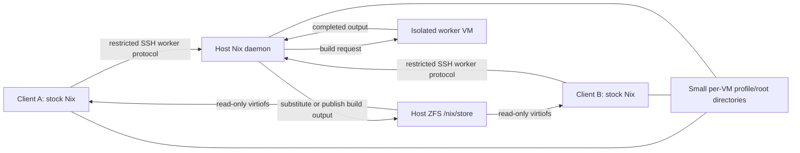

# Shared Nix store prototype

The October 31, 2026 resolvr-box proof demonstrated a live, host-owned Nix store
used by two Homecloud VMs. Both clients ran **unmodified Nix 2.35.4**. A request
from client A was built in a third, isolated VM; client B then executed the same
host store object through read-only virtiofs. A path that B had already looked up
and found missing appeared without a remount or a mount-ID change.

This is an experimental lab tool, not an enabled Homecloud application. The Rust
runner is in `crates/nix-lab`; it invokes existing Homecloud, SSH, Incus, ZFS and
Nix tools for OS configuration. It does not implement a new Nix daemon, patch
Nix, or add a production API or GUI.

## Layout



Clients use Nix's experimental `mounted-ssh-store` feature and set
`NIX_REMOTE=mounted-ssh-ng://hc-nix-store`. Nix queries validity, adds inputs and
requests builds through the SSH worker protocol, while ordinary file reads and
program execution use the mounted store. The host owns the store database and
publishes completed paths. Neither client mounts the database, and guest root
cannot write to the store export. No generation switch is required for additions.

The host endpoint is a separate sshd on the two client bridge gateways, port
12222. Its forced command is `nix-daemon --stdio`; passwords, tunnels and
forwarding are disabled. Only the corresponding client IP can reach its gateway
endpoint through the scoped firewall exceptions. Each VM authenticates as a
different **untrusted** Nix user. Private keys stay on the client/host that uses
them; the runner copies public keys over pinned management SSH. The worker host
key is also pinned, using `base64-ssh-public-host-key`.

The host has `max-jobs = 0`, a dedicated **empty** build-user group, and
`trusted-users = root`. A guest request with override flags still built in the
worker. A direct daemon request under the same untrusted host identity could not
override `sandbox` or `build-users-group`; a forced local build failed because
that group had no members. The empty group provides a barrier beyond the default
job count. The worker runs a sandboxed multi-user Nix daemon. The test output
includes a nonce read from a file available only inside that worker's sandbox.

## What was proven

The reviewed, credential-free summary is in
[`lab/evidence/nix-shared-store-20261031.json`](../lab/evidence/nix-shared-store-20261031.json).
Raw manifests, endpoint profiles and transcripts stay outside Git.

| Check | Result |
| --- | --- |
| Stock guest Nix | Both clients reported 2.35.4; store info reported `trusted: false` |
| VM-originated build | A requested a pinned nixpkgs derivation; sandbox marker proved worker execution |
| Shared output | B requested the same derivation and executed the same path; host and B reported inode 10302 for the executable |
| Live addition | B looked up a missing second output, A built it, B executed it with mount ID 58 unchanged; host/B inode 10725 |
| Write denial | Guest root writes failed with `Read-only file system` in both clients |
| Profiles and development shell | `nix build --out-link`, `nix develop --profile`, and `nix profile add` worked with shared per-VM state |
| GC retention | After removing the temporary host root, GC found the guest's result, dev-profile and profile-generation roots and refused to delete the live output |
| Reclamation | Targeted GC deleted a separate unrooted proof output; it disappeared from both clients |
| Endpoint outage | An installed executable still ran; a store request failed with connection refused |
| Client reboot | B returned with a changed boot ID, reconnected as untrusted, executed the original output, and still rejected writes |
| Host build policy | Restricted setting overrides were ignored; a direct untrusted local build failed before execution |

This was a functional test, not a disk or throughput benchmark. The host dataset
reported 105,218,048 allocated bytes after the first build. That number includes
the Nix installation, source data and dependencies, with ZFS compression; it is
not a measured savings figure. The two clients do not keep installed copies of
the shared store in their virtual disks. The worker **does** keep its own build
store, so this prototype does not eliminate duplication between the worker and
the publishing host.

## Compatibility details discovered on this host

The Ubuntu client image's original `6.8.0-147-generic` kernel failed to execute
ELF binaries whose interpreter was on the virtiofs store (`Bad address`). Updating
only the disposable clients to `linux-generic-hwe-24.04` installed
`7.0.0-42-generic` and fixed that execution failure.

Normal-user execution then failed with `Operation not supported` until the
prototype ZFS dataset was configured with `acltype=posix`. Root-only smoke tests
had missed this. Both the newer guest kernel and the POSIX ACL setting were
required in this particular setup. They are not assertions about every kernel,
filesystem or virtiofs configuration.

Incus initially reported the hotplugged mount as `rw`, but the virtiofs server
already rejected writes because the device was configured `readonly=true`. The
runner additionally remounts the guest view read-only. Write denial survived the
client reboot.

## Profiles and garbage collection are the main integration work

The mounted SSH store creates some links on the remote host. A normal
`nix build -f package.nix` in `/home/dev/hcnix-proof` failed when it attempted to
create the host-side guest-private directory. Allowing the operation while
ignoring roots would also be unsafe: the host cannot inspect a guest's private
filesystem or `/proc` to discover everything the VM still needs.

The working proof uses a small directory per VM mounted at the **same absolute
path** on both sides:

```
/nix/lab-roots/<run-id>/client-a
/nix/lab-roots/<run-id>/client-b
```

Each directory has ACLs for its guest UID and corresponding host Nix identity,
including prepared `nix/profiles` directories. Other client identities are not
given write access. With `XDG_STATE_HOME` pointed there, these commands worked:

```sh
nix build -f package.nix --out-link "$XDG_STATE_HOME/result"
nix develop -f package.nix --profile "$XDG_STATE_HOME/dev-profile" \
  --command sh -c 'printf "develop-ok\n"'
nix profile add -f package.nix
```

The development shell succeeded but emitted an ignored permission error for
host-side `/home/dev/.cache/nix`. This prototype has not completed cache-path
integration. A product also needs a deliberate policy for project-local result
links, profile generations, temporary closures, running guest processes, stopped
VMs, deletion, and disconnected clients. The small shared state directory proves
one workable retention mechanism; it is not transparent support for arbitrary
guest paths. GC was tested using liveness queries and targeted deletion, not a
full collector run while guest programs were concurrently using unrooted paths.

## Product implications

A Rust Homecloud service can own this configuration and its lifecycle while
leaving Nix unchanged. It should register each VM, provision a scoped identity,
attach the read-only store, maintain retention roots/leases, and expose service
health, physical store allocation, closure references, GC eligibility and build
queue information. Shared physical bytes and per-VM logical references need
separate accounting. This prototype does not implement those production metrics.

A shared store is readable by every VM attached to it. Packages, derivations and
source inputs placed there must be appropriate for that trust group; separate
stores are needed when that visibility is unacceptable. Immutability and Nix
validation protect integrity but do not provide confidentiality. Not every Nix
store path is a pure hash of its output bytes: ordinary derivations are generally
input-addressed. Reuse here is reuse of an already valid store path, not generic
block deduplication or proof that every build is reproducible.

Further work before enabling this for everyday VMs includes per-VM quotas and
fairness, GC/lease recovery, supported image/kernel selection, host restart and
upgrade behavior, publication crash recovery, tenant isolation review, and
performance testing. Rebooting the **physical host**, concurrent publication
stress, a running-guest GC race and multi-tenant adversarial testing were not part
of this proof. No shared page-cache or RAM deduplication claim was tested.

## Running and restoring the lab

This runner is intentionally specific to resolvr-box's x86_64 Ubuntu/Incus/ZFS
lab. It requires an administrator Homecloud CLI profile and pinned independent
management SSH. It retains fixtures on failure. Do not start a second
resource-changing proof on the host while it runs. Reserve six GiB RAM, three
cores, 44 GiB of VM disks, and a separate 16 GiB shared-store dataset reservation;
`prepare` conservatively leaves 50 GiB of disk grant headroom. Existing VMs and
managed applications must remain outside the manifest.

```sh
cargo build -p homecloud-nix-lab
LAB_STATE=/private/tmp/homecloud-nix-proof/state.json
LAB_SSH="$HOME/.config/homecloud/host-access/resolvr-box/ssh_config"
LAB_CLI=/path/to/working/homecloud
# Use these same global arguments on every invocation:
target/debug/homecloud-nix-lab --state "$LAB_STATE" \
  --ssh-config "$LAB_SSH" --cli "$LAB_CLI" prepare
```

Run `install host`, `install builder`, and `install kernels`, waiting for both
clients to return from their kernel reboot. Then run `install clients`,
`install transport`, `exercise connect`, `exercise source`, `exercise build`,
`exercise live`, `install roots`, `exercise rooted-commands`,
`exercise guest-private-root`, `exercise isolation`, `exercise gc`, and
`exercise recovery`. The source phase pins the resolved nixpkgs revision in the
private manifest directory on the host; subsequent phases use that revision.
The live and GC phases deliberately create/delete particular objects and are
not blindly repeatable. Inspect retained state after any failure. The final
runner incorporates the fixes found during the incremental live proof; a full
fresh run of the final sequence has not been performed. The host phase refuses
to adopt an existing Nix installation or colliding lab identities.

`uninstall` checks fixture identities, store tags, original shell backup and
installer account identities, then removes owned exports, services, firewall
exceptions, accounts, installer files and the tagged dataset. The active marker
is removed last. `cleanup` then deletes the exact manifest VM IDs through the
Homecloud API and restores the captured grant only if it has not drifted.
Preparation and restoration fence both the resource grant and GPU authorization.
Preparation requires a successful inventory and state query for every protected
VM before saving the baseline. Cleanup also checks live application records,
including applications installed after fixture creation, before deleting a VM.
Cleanup persists each deletion intent before submitting it and reconciles the
controller's recorded deletion operations on retry. It verifies the identity of
every surviving fixture, requires host absence after confirmed deletion, and
retains the protected-VM checks throughout. If a request fails or the runner
exits during deletion or grant restoration, resume `cleanup` with the same state
file; it does not require deleted fixtures to reappear. Missing fixtures without
recorded successful deletion, failed operations, and policy drift require review.
Incomplete teardown requires inspection and explicit repair with the fenced
`host`/`guest` commands; a timeout does not authorize broader deletion.

The October 31 run temporarily raised only the managed disk baseline from 128 to
192 GiB because existing VM disk claims left insufficient room for the fixtures.
`nix-lab-disk-budget` performs this narrow offline migration under the controller
and host-operation locks, backs up the database/configs, verifies pending work
and promises, preserves config modes/owners, and restarts the controller. It
changes no VM records or grants. Reverse the migration after deleting fixtures
and restoring the grant. Never restore the entire old database over newer state.
The original running development VM was gracefully stopped with permission and
must be restarted at its original 16 GiB / 3-core / 64 GiB size before releasing
the host to another proof.

## Final host state

Teardown and restoration were verified before the host was handed to the VM
telemetry thread. All three proof VMs and the shared dataset/reservation are gone.
The original grant and 128 GiB disk baseline are restored. `homecloud-devbox` is
running at its original 16 GiB / 3 cores / 64 GiB, with a successful start operation.
`gh-cli-test` retained QEMU PID 3930767 throughout; `t3-devbox` remained stopped.
The controller is healthy, and both config files have their original modes and
owners. The original shell configuration is restored.

Only inactive, root-private audit artifacts remain under
`/var/lib/homecloud/nix-lab/<run-id>` and
`/var/lib/homecloud/test-runs/nix-shared-store-20261031`. These include the
configuration/database backups and archived fetch-cache metadata. Runtime
services, exports, accounts, firewall rules, generated private keys, installer
stage and helper checkout were removed. The explicit host release has been sent;
this prototype reserves no further host access. Do not restore the archived old
database over newer controller state.

## Upstream references

- [Mounted SSH store and root visibility](https://nix.dev/manual/nix/2.35/store/types/experimental-ssh-store-with-filesystem-mounted.html)
- [Distributed builds and pinned worker keys](https://nix.dev/manual/nix/2.35/advanced-topics/distributed-builds.html)
- [Incus disk devices and read-only exports](https://linuxcontainers.org/incus/docs/main/reference/devices_disk/)
- [Nix multi-user uninstall](https://nix.dev/manual/nix/2.35/installation/uninstall.html)
